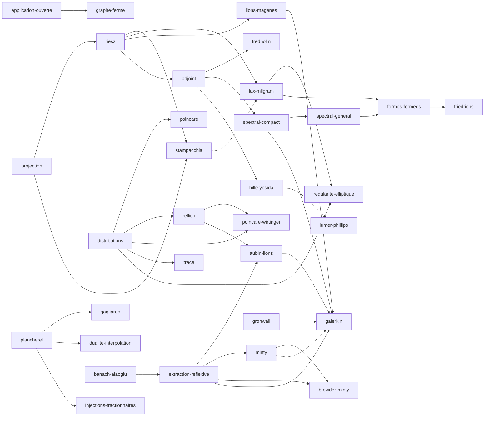

# ProofLab — Theorem Engine : plan d’implémentation

Ce document fixe l’architecture, le modèle de données, le système de validation, le graphe de dépendances, la navigation et la progression. Il consigne aussi les décisions techniques et leurs raisons.

## 1. Audit initial

- Répertoire de travail vide à l’origine. Aucune application existante à préserver.
- Sources : `Polycopie_Complements_Analyse_Fonctionnelle_EDP.pdf` (46 pages, copie locale dans `source-materials/`, original conservé hors du projet) ; `main.pdf` (« Socle EDP, Scientific Machine Learning et PINNs », 1 174 pages), consulté pour le contexte seulement.
- Extraction texte page par page : `source-materials/extraits/polycopie_texte_par_page.txt` (marqueurs `<<<PAGE n>>>` = pages du PDF ; page imprimée = page PDF − 4).
- Le polycopié contient la carte des 34 résultats (p. PDF 37) et les 102 exercices classés par théorème (p. PDF 38–44) : le contenu du jeu part de ces énoncés.
- Node.js était absent du système : une copie portable officielle (v26.13.0, somme SHA-256 vérifiée) est placée dans `.tools/node`, sans rien modifier hors du projet.

### Erreur relevée dans le polycopié

Section 8 (p. PDF 31 et 32) : l’estimation a priori est écrite
$\sup_t\|u(t)\|_H^2+\int_0^T\|u\|_V^2\le\|u_0\|_H^2+\|f\|^2_{L^2(0,T;V')}$.
Elle est fausse telle quelle : avec $f=0$ et $u_0=\varphi_1$, le membre de gauche vaut $1+\frac{1-e^{-2\lambda_1T}}{2}>1$. La forme correcte, utilisée partout dans ProofLab et vérifiée par un test, est : pour tout $t$, $\|u(t)\|_H^2+\int_0^t\|u\|_V^2\le\|u_0\|_H^2+\int_0^t\|f\|_{V'}^2$, d’où la somme bornée par $2(\|u_0\|_H^2+\|f\|^2_{L^2(V')})$. Les autres écarts relevés par les auteurs de contenu sont dans `docs/notes/`.

## 2. Architecture

| Dossier | Rôle |
|---|---|
| `src/core/math/` | Rationnels exacts (BigInt), polynômes et fractions rationnelles, matrices exactes (Sylvester), vérifications fermées ; modèles mathématiques des laboratoires |
| `src/core/proof-engine/` | Moteur de preuve (règles, pièges, cycles, ancrage, retrait d’hypothèse, notation), preuve libre |
| `src/core/progression/` | SM-2, maîtrise, déverrouillage, file de révision |
| `src/content/` | Schémas typés (zod), catalogue et graphe de dépendances, concepts, un module par théorème |
| `src/components/` | Interface : mise en page, rendu KaTeX, éditeur de preuve |
| `src/labs/` | Laboratoires A à E et leur boîte à outils |
| `src/pages/` | Écrans |
| `src/storage/` | Sauvegarde IndexedDB, export/import validés, état global (Zustand) |
| `src/tests/`, `e2e/` | Tests unitaires et de contenu (Vitest), tests de bout en bout (Playwright) |
| `server/` | Correcteur IA optionnel, désactivé par défaut |

### Pile technique et écarts justifiés

React 19, TypeScript strict, Vite, Tailwind 4, KaTeX, Zustand, IndexedDB, Vitest, Playwright : conformes à la demande.

- **shadcn/ui non utilisé** : une dizaine de composants suffisent (`src/components/ui.tsx`) ; l’ajout aurait imposé Radix et un outillage de génération pour un gain nul.
- **React Flow non utilisé** : le graphe de preuve est un DAG en couches rendu en HTML + SVG (`ProofGraph.tsx`). Chaque nœud est un vrai bouton : navigation clavier, libellés accessibles et tests de bout en bout restent simples. Le glisser-déposer libre n’apporte rien à une preuve dont la disposition est déterminée par ses dépendances.
- **D3 non utilisé** : les graphiques des laboratoires sont des SVG et un canvas écrits à la main (`src/labs/kit.tsx`), avec des échelles linéaires simples.
- **Zod** pour les schémas : un seul schéma sert au typage, à la validation du contenu et à la validation des sauvegardes importées.
- **HashRouter** : l’application fonctionne servie par Vite comme depuis n’importe quel serveur statique.
- **PWA légère** : manifeste et service worker minimal, actif seulement en production.

## 3. Modèle de données

- `catalog.ts` : 8 mondes, 34 résultats, prérequis (`requires`), chemins alternatifs autorisés (`alsoAllowed`), outils admis (Baire, Zorn, Tychonoff…), pages du polycopié, laboratoire associé.
- `TheoremModule` (un fichier `worlds/wN/tNN-<id>.ts`, découvert automatiquement) : fiche du théorème (espaces, hypothèses avec contre-exemple quand on les retire, énoncé, bilan existence/unicité/régularité/stabilité, plan de preuve, points de vigilance, statut de vérification), définitions, concepts, tâches de contre-exemple, trois exercices.
- `Exercise` : énoncé, niveau, source (page PDF), prérequis, concepts, `ProofSpec`, vérifications fermées, solution, étapes, erreurs fréquentes, trois indices (orientation, structure, déblocage), grille à cinq critères sur 100 points, variante (avec ou sans graphe), statut de vérification.
- `ProofSpec` : nœuds (hypothèse, définition, égalité, inégalité, inclusion, conséquence, application d’un théorème, conclusion, contradiction), banque de justifications (valides et fausses), règles `{from, to, by}` (plusieurs règles de même conclusion = plusieurs chemins), pièges `{conclusion, premises?, by?, verdict, message, concept, counterexample?}`, hypothèses retirables, but.

## 4. Système de validation

### A — déterministe
- Rationnels exacts ; identités de polynômes et de fractions rationnelles par forme normale et produit en croix. Jamais d’évaluation en points d’essai : une proximité numérique est refusée avec un message dédié.
- Matrices : symétrie, caractère défini positif (Sylvester), semi-défini (tous les mineurs principaux), coercivité `S − αG ⪰ 0`.
- Vérifications fermées : `rational`, `rational-vector`, `expr-equiv`, `matrix-spd`, `choice`.

### B — structurelle
Pour une étape (S, P, J) : hypothèse disponible → donnée ; piège reconnu → « Incorrect » ou « À justifier » selon qu’une erreur est caractérisée ; théorème non disponible → « Incorrect » (utilisation prématurée, contrôlée par le DAG) ; règle (S, J) dont les prémisses sont incluses dans P → « Validé » ; prémisses manquantes → « À justifier » ; aucune règle → « À justifier, lien non couvert ». Au niveau du graphe : détection des cycles, ancrage par plus petit point fixe à partir des hypothèses, retrait d’hypothèse et recalcul.

### C — preuve libre
Éditeur Markdown + LaTeX avec aperçu. Verdict par défaut « À justifier » ; « Incorrect » seulement sur un calcul fermé refusé ; points d’attention présentés comme indices de relecture, sans effet sur la progression ; auto-évaluation sur la grille signalée non formelle ; correcteur IA optionnel (`server/ai-proxy.mjs`), désactivé par défaut, clé côté serveur uniquement.

## 5. Graphe de dépendances

Arêtes « A ← B » : la démonstration de A utilise B. Les flèches en pointillés sont des chemins alternatifs autorisés.

Un exercice de **démonstration** ne peut invoquer que les ancêtres stricts du résultat ; un exercice d’**application** peut invoquer le résultat, ses ancêtres et ses prérequis déclarés. Le test `engine.test.ts` vérifie l’acyclicité.

## 6. Navigation

Accueil, Carte, Fiche théorème, Éditeur de preuve, Preuve libre, Contre-exemples, Examen, Révisions, Tableau de bord, Carnet, Laboratoires, Mode libre, Réglages. Barre latérale sur ordinateur, barre supérieure défilante sur tablette.

## 7. Progression

- **SM-2** par exercice ; la qualité est déduite de la tentative (indices consultés, étapes refusées, solution consultée). Une réussite avec indice de déblocage vaut q = 2 : elle n’allonge pas l’intervalle.
- **Maîtrise** par théorème : poids 0,20 / 0,35 / 0,45 par niveau × autonomie (1 ; 0,7 ; 0,4 ; 0,15 selon l’indice maximal) × rétention (plancher 0,5). « Maîtrisé » exige le niveau difficile résolu avec au plus un indice d’orientation.
- **Déverrouillage** : un résultat s’ouvre quand chacun de ses prérequis a un exercice résolu ; le mode libre et un réglage ouvrent tout.
- **Révisions** : cartes dues, présentées en variante ou en réutilisation dans un autre résultat lorsque c’est possible ; pause sans pénalité (décalage de toutes les échéances).

## 8. Phases et état

| Phase | Contenu | État |
|---|---|---|
| 1 | Audit, architecture, modèles, validation, DAG | fait |
| 2 | Application jouable : interface, carte, fiches, éditeur guidé, sauvegarde | fait |
| 3 | Monde I complet | fait |
| 4 | Cinq laboratoires | fait (A, B, C, D, E) |
| 5 | Huit mondes, 102 exercices | fait : 34 modules, 102 exercices, tous validés automatiquement |
| 6 | SM-2, tableau de bord, examen, export/import, preuve libre | fait |
| 7 | Tests, rendu, documentation | fait : 313 tests unitaires, 13 tests de bout en bout, captures sombre/clair, bureau/tablette |

Le contenu a été rédigé par des agents, chacun sur ses fichiers, avec le guide `docs/GUIDE_CONTENU.md` et le validateur `src/tests/content/validate.ts`. Six relecteurs indépendants ont ensuite vérifié chaque module contre le polycopié : 66 corrections (aucune sur un énoncé de théorème), 136 fiches et exercices marqués « relus » dans `src/content/reviews/`, rapports dans `docs/notes/`. Cette relecture est faite par IA : ce n’est ni une validation humaine ni une preuve formelle.
